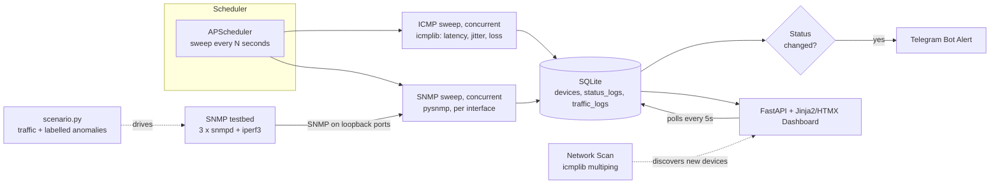

# NetWatch NMS

A self-hosted Network Monitoring System built for a hotel IT environment — tracks the up/down status, latency, and SNMP interface traffic of local network devices, grouped by area, with a live dashboard, network auto-discovery, and Telegram alerts on status changes.

Originally built as an internship project, now also the data-collection foundation for a Tugas Akhir (thesis) on ML-based network traffic anomaly detection — scoped to cover industry-standard monitoring methods (ICMP + SNMP) without the operational overhead of a full enterprise NMS.


## Features

- **Live dashboard** — device status, latency, 24 h uptime, and a response-time sparkline per device, grouped by area (Room / Public / Office) and labelled by network segment (wired / wireless), auto-refreshing every 5 seconds with no page reload
- **ICMP + SNMP monitoring, polled concurrently** — each sweep sends several ICMP packets per device (average latency, jitter, packet loss), then reads `sysName`/`sysUpTime` and IF-MIB interface counters (64-bit `ifHC*` octets with a 32-bit fallback, errors, discards) via SNMP, including multi-interface devices. All devices are polled in parallel, so sweep time stays roughly constant as devices are added
- **Network auto-discovery** — scan a CIDR range, with one-click presets for the configured subnets, and add what's found in one click
- **Bulk targets** — import a CSV of devices, and list a device's interfaces with `discover_interfaces.py` to pick the right ifIndex
- **Simulated SNMP testbed** — three containers with real `snmpd` agents, real iperf3 traffic on a daily pattern, and injected anomalies logged with exact start/end times, for the hybrid ICMP (real network) + SNMP (simulated) setup
- **Telegram alerts** on every up/down transition
- **Single-admin login** (bcrypt password hash + signed session cookie)
- **Runs in the background** — a hidden launcher for Windows + WSL (low priority, no window) or a Docker service with restart policy, health check and resource limits
- **Data tools** — a completeness/reliability report and a CSV/JSON export script (with segment and counter-width columns), both built for the eventual ML pipeline
- **Tested** — pytest coverage across routing, polling sweeps, segments, scripts, auth, and the testbed scenario runner

## Problem Statement

Small hospitality properties often run a mix of networking gear and shared devices (room routers, lobby APs, office printers, PMS terminals) with no centralized way to know when something goes down — issues surface only when a guest or staff member complains. NetWatch gives IT staff a single dashboard showing live status across all monitored devices, with instant Telegram alerts the moment something drops offline, and network scanning to make onboarding new devices fast instead of manual.

## Architecture



## Tech Stack & Why

| Layer | Choice | Why |
|---|---|---|
| Backend | FastAPI | Async-friendly for I/O-bound polling; minimal boilerplate |
| Database | SQLite + SQLAlchemy | Zero-config, single-file, sufficient for a bounded device count |
| Scheduler | APScheduler | In-process background polling, no separate worker/queue needed |
| Monitoring | icmplib (ICMP), pysnmp (SNMP) | The two industry-standard reachability/status protocols |
| Frontend | Jinja2 + HTMX | Live-updating dashboard with no separate JS build pipeline |
| Auth | bcrypt + signed session cookie | Single-admin scope — no need for JWT/OAuth complexity |
| Alerting | Telegram Bot API | Free, instant, no SMTP/infra setup required |
| Packaging | Docker + docker-compose | One-command reproducible run for anyone reviewing the project |

## Setup

### Local (WSL/Linux)

```bash
git clone <your-repo-url>
cd netwatch-nms
python3.12 -m venv venv
source venv/bin/activate
uv pip install -r requirements.txt

cp .env.example .env
mkdir -p data logs

python scripts/generate_password_hash.py

uvicorn app.main:app --reload
```
Visit `http://127.0.0.1:8000/` and log in with the username/password you configured.

### Everyday use on Windows (no terminal)

Copy `launcher/NetWatch-Start.bat`, `launcher/NetWatch-Stop.bat` and `launcher/NetWatch-Hidden.vbs` to the same folder on the Windows Desktop (or anywhere convenient):

- **NetWatch-Start.bat** starts the server inside WSL with no visible window, waits until it's ready, and opens the dashboard in your browser. If it's already running, it just opens the browser.
- **NetWatch-Start.bat /background** starts it silently and returns immediately, without opening a browser. Use this one for startup.
- **NetWatch-Stop.bat** shuts the server down.
- To start automatically at login, press `Win + R`, run `shell:startup`, and put a shortcut there whose target is `NetWatch-Start.bat /background`.

If your WSL distro isn't named `Ubuntu` or the project lives somewhere else, edit the two `set` lines at the top of `NetWatch-Start.bat` (and the `DISTRO` line in `NetWatch-Stop.bat`).

### Running in the background without disturbing the host

| | Windows + WSL (launcher above) | Docker service |
|---|---|---|
| Start | `NetWatch-Start.bat /background` | `docker compose up -d --build` |
| Isolation | Runs inside WSL, hidden window, `nice 10` priority | Own container, 512 MB / 1 CPU caps |
| Survives reboot | Via the startup shortcut | `restart: unless-stopped` (enable "Start Docker Desktop when you sign in") |
| Logs | `logs/netwatch.log` (rotating), `logs/server.out` (last start) | `docker compose logs -f`, plus `./logs/` |
| Best for | Your own PC | An always-on machine |

Access logging is switched off in both modes: the dashboard polls every 5 seconds and would otherwise fill the log.

To cap how much memory and CPU WSL as a whole may use, create `%UserProfile%\.wslconfig` and run `wsl --shutdown` once (this restarts every WSL session):

```ini
[wsl2]
memory=2GB
processors=2
```

### Docker

```bash
cp .env.example .env
docker compose up -d --build
```
Visit `http://localhost:8000/`. The SQLite database and logs persist on the host under `./data/` and `./logs/`. The port is bound to localhost; change it to `"8000:8000"` in `docker-compose.yml` to open the dashboard to the LAN.

## Targets and network segments

The property has two subnets, set in `.env`:

```
NETWORK_SEGMENTS=wired=192.168.1.0/24,wireless=192.168.110.0/24,testbed=127.0.0.0/8
```

A device's segment is derived from its IP at read time (never stored), so it shows as a badge on the dashboard and as a `segment` column in every export. The wired and wireless ranges also appear as one-click presets in **Scan Network**.

- **Starting from scratch:** stop the app, then `python scripts/reset_database.py` backs the old database up to `data/backups/` and creates a fresh one with the current schema. It is also how schema changes get applied, since the app never alters existing tables.
- **Adding many targets:** copy `data/devices.example.csv` to `data/devices.csv`, fill it in, then `python scripts/import_devices.py data/devices.csv --dry-run` and again without `--dry-run`.
- **Choosing interfaces:** `python scripts/discover_interfaces.py <ip> --community <read-community>` lists each interface's ifIndex, name, status and 64-bit counter support.
- **Wireless subnet:** register infrastructure (access points, controllers), not guest phones. Their addresses change and many don't answer ping. Also check that the machine running NetWatch can route to the wireless subnet at all; guest networks are often isolated.

## Hybrid ICMP + SNMP with the simulated testbed

When SNMP access to production devices isn't available, the SNMP half can come from a simulated network while ICMP is still measured on the real one. The testbed is three containers, each running a real `snmpd` agent and an iperf3 server, so the counters are genuine kernel counters, not invented numbers.

```bash
docker compose -f testbed/docker-compose.yml up -d --build
python scripts/register_testbed.py
python testbed/scenario.py --day-minutes 120 
python scripts/export_data.py
docker compose -f testbed/docker-compose.yml down
```

- NetWatch runs on the host (the launcher or `uvicorn`) and reaches the nodes through loopback ports 1161-1163, which works the same with native Docker and Docker Desktop. Several SNMP agents behind one IP are distinct devices because a device is identified by IP **and** SNMP port.
- `scenario.py` writes `testbed/runs/<UTC time>/ground_truth.csv` (anomaly kind, target, exact start and end in UTC, the same clock as the database) and `meta.json` with the seed. `--no-anomalies` produces clean normal-behaviour data; `--seed` makes a run reproducible.
- Anomalies never overlap, so every label is unambiguous: traffic floods, silences and sustained high load per link, plus packet loss and added latency per node via `tc netem`. If the kernel lacks `netem`, the runner says so and skips those two kinds.
- For a compressed day (`--day-minutes 120`), lower `PING_INTERVAL_SECONDS` in `.env` (for example 10) so each simulated hour still gets enough samples.

## Scripts

- `scripts/generate_password_hash.py` — generates the bcrypt hash for `ADMIN_PASSWORD_HASH`
- `scripts/reset_database.py` — backs up the database and creates a fresh one (also applies schema changes)
- `scripts/import_devices.py` — bulk-adds monitoring targets from a CSV
- `scripts/discover_interfaces.py` — lists a device's interfaces so you can pick ifIndex values
- `scripts/register_testbed.py` — registers the simulated SNMP nodes as devices
- `scripts/data_quality_report.py` — per-device completeness/uptime/gap/loss report, for validating the dataset before relying on it
- `scripts/export_data.py` — exports devices/status_logs/traffic_logs to CSV or JSON for notebook/ML use
- `scripts/run_server.sh` — starts the app for everyday use (no `--reload`, low priority), used by the Windows launcher
- `testbed/scenario.py` — drives the simulated network: daily-pattern traffic plus labelled anomalies

## Testing

```bash
pytest -v
```
Route tests run against an isolated in-memory database and bypass the real scheduler/lifespan entirely — they never touch `data/netwatch.db` or send real Telegram messages.

## Design Decisions

**ICMP + light SNMP, not full SNMP trap listening.** Full SNMP trap infrastructure is genuinely industry-standard at scale, but disproportionate for a bounded set of known devices. Polling ICMP for reachability/latency plus SNMP GETs for sys info and interface counters covers "is it up, and what's its traffic doing" without that overhead.

**SQLite, not a time-series database.** Both `status_logs` (ICMP) and `traffic_logs` (SNMP) are kept in full, indexed on `(device_id, timestamp)`; the dashboard only ever reads a 24 h aggregate and the latest few readings, so it stays fast as history grows. A sweep of 30 devices adds roughly 40,000 status rows a day at a 60 s interval, which SQLite handles comfortably. This wouldn't scale gracefully past a few hundred devices, which is the point at which a real time-series store would earn its complexity.

**Concurrent sweeps.** ICMP for every device runs in one concurrent pass and SNMP for every responding device in another, on one shared SNMP engine that is closed after each sweep. Polling devices one after another would make a sweep take longer than the poll interval as soon as a few devices were down.

**Hybrid data: real ICMP, simulated SNMP.** Production SNMP access isn't always obtainable, so the SNMP side can come from a testbed of real agents carrying real traffic, with anomalies injected on a schedule and logged. That gives labelled data the real network can't, at the cost that traffic-volume results describe the testbed, not the property's own traffic. Both sources are tagged (segment and device group) so they are never mixed by accident.

**Segment derived from IP, not stored.** A device's wired/wireless label is computed from its address and the configured ranges, so changing a range relabels history consistently instead of leaving stale values in old rows.

**HTMX, not React.** The dashboard needs live-updating status cards, not complex client-side state. HTMX polling delivers that with server-rendered HTML fragments and zero JS build tooling, at the cost of a 5-second poll interval instead of instant push — an acceptable trade-off for status data that changes on the order of seconds/minutes.

**Single-admin bcrypt auth, not JWT/OAuth.** One person manages this system. Session-cookie auth with a bcrypt-hashed password covers the real requirement (keep this off the open internet) without the complexity of multi-user roles, refresh tokens, or an identity provider that this scope doesn't need.

**ICMP-only network discovery, not ARP scanning.** ARP scanning is more reliable for local-subnet discovery but typically needs raw-socket privileges and only works within one broadcast domain. ICMP sweeping (via `icmplib.multiping`) works anywhere IP routing reaches, requires no elevated privileges, and is good enough for this scope — the real limitation is that devices with strict firewalls won't respond to ping even if they're alive, a known gap rather than a bug.

## License

See [LICENSE](LICENSE).
