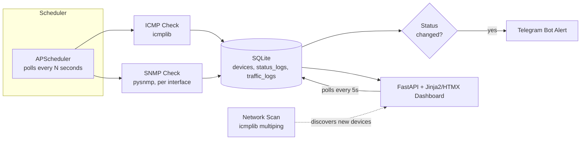

# NetWatch NMS

A self-hosted Network Monitoring System built for a hotel IT environment — tracks the up/down status, latency, and SNMP interface traffic of local network devices, grouped by area, with a live dashboard, network auto-discovery, and Telegram alerts on status changes.

Originally built as an internship project, now also the data-collection foundation for a research on ML-based network traffic anomaly detection — scoped to cover industry-standard monitoring methods (ICMP + SNMP) without the operational overhead of a full enterprise NMS.


## Features

- **Live dashboard** — device status, latency, uptime %, and a response-time sparkline per device, grouped by area (Room / Public / Office), auto-refreshing every 5 seconds with no page reload
- **ICMP + SNMP monitoring** — reachability/latency via ICMP, plus `sysName`/`sysUptime` and IF-MIB interface traffic counters (in/out bytes, errors, discards) via SNMP, including multi-interface devices
- **Network auto-discovery** — scan a CIDR range (e.g. `192.168.1.0/24`) to find devices already on the network, with one-click add for anything discovered
- **Telegram alerts** on every up/down transition
- **Single-admin login** (bcrypt password hash + signed session cookie)
- **Data tools** — a completeness/reliability report and a CSV/JSON export script, both built for the eventual ML pipeline
- **Dockerized**, with persistent SQLite + log volumes
- **Tested** — pytest coverage across routing, polling logic, and auth

## Problem Statement

Small hospitality properties often run a mix of networking gear and shared devices (room routers, lobby APs, office printers, PMS terminals) with no centralized way to know when something goes down — issues surface only when a guest or staff member complains. NetWatch gives IT staff a single dashboard showing live status across all monitored devices, with instant Telegram alerts the moment something drops offline, and network scanning to make onboarding new devices fast instead of manual.

## Architecture



## Tech Stack & Why

| Layer | Choice | Why |
|---|---|---|
| Backend | FastAPI | Async-friendly for I/O-bound polling; minimal boilerplate |
| Database | SQLite + SQLAlchemy | Zero-config, single-file, sufficient for a bounded device count |
| Scheduler | APScheduler | In-process background polling, no separate worker/queue needed |
| Monitoring | icmplib (ICMP), pysnmp (SNMP) | The two industry-standard reachability/status protocols |
| Frontend | Jinja2 + HTMX | Live-updating dashboard with no separate JS build pipeline |
| Auth | bcrypt + signed session cookie | Single-admin scope — no need for JWT/OAuth complexity |
| Alerting | Telegram Bot API | Free, instant, no SMTP/infra setup required |
| Packaging | Docker + docker-compose | One-command reproducible run for anyone reviewing the project |

## Setup

### Local (WSL/Linux)

```bash
git clone <your-repo-url>
cd netwatch-nms
python3.12 -m venv venv
source venv/bin/activate
uv pip install -r requirements.txt

cp .env.example .env
mkdir -p data logs

# Generate your login password hash and paste it into .env as ADMIN_PASSWORD_HASH
python scripts/generate_password_hash.py

uvicorn app.main:app --reload
```
Visit `http://127.0.0.1:8000/` and log in with the username/password you configured.

### Docker

```bash
docker compose up --build
```
Visit `http://localhost:8000/`. The SQLite database and log files persist on the host under `./data/` and `./logs/`.

## Scripts

- `scripts/generate_password_hash.py` — generates the bcrypt hash for `ADMIN_PASSWORD_HASH`
- `scripts/data_quality_report.py` — per-device completeness/uptime/gap report, for validating the dataset before relying on it
- `scripts/export_data.py` — exports devices/status_logs/traffic_logs to CSV or JSON for notebook/ML use

## Testing

```bash
pytest -v
```
Route tests run against an isolated in-memory database and bypass the real scheduler/lifespan entirely — they never touch `data/netwatch.db` or send real Telegram messages.

## Design Decisions

**ICMP + light SNMP, not full SNMP trap listening.** Full SNMP trap infrastructure is genuinely industry-standard at scale, but disproportionate for a bounded set of known devices. Polling ICMP for reachability/latency plus SNMP GETs for sys info and interface counters covers "is it up, and what's its traffic doing" without that overhead.

**SQLite, not a time-series database.** For a fixed, small device count, a pruned `status_logs` table (dashboard-facing) plus an unpruned `traffic_logs` table (ML-facing) covers both needs without a second service to deploy. This wouldn't scale gracefully past a few hundred devices — that's the point at which a real time-series store would earn its complexity.

**HTMX, not React.** The dashboard needs live-updating status cards, not complex client-side state. HTMX polling delivers that with server-rendered HTML fragments and zero JS build tooling, at the cost of a 5-second poll interval instead of instant push — an acceptable trade-off for status data that changes on the order of seconds/minutes.

**Single-admin bcrypt auth, not JWT/OAuth.** One person manages this system. Session-cookie auth with a bcrypt-hashed password covers the real requirement (keep this off the open internet) without the complexity of multi-user roles, refresh tokens, or an identity provider that this scope doesn't need.

**ICMP-only network discovery, not ARP scanning.** ARP scanning is more reliable for local-subnet discovery but typically needs raw-socket privileges and only works within one broadcast domain. ICMP sweeping (via `icmplib.multiping`) works anywhere IP routing reaches, requires no elevated privileges, and is good enough for this scope — the real limitation is that devices with strict firewalls won't respond to ping even if they're alive, a known gap rather than a bug.

## License

See [LICENSE](LICENSE).