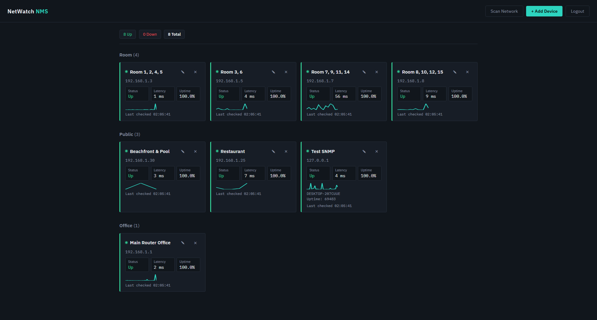
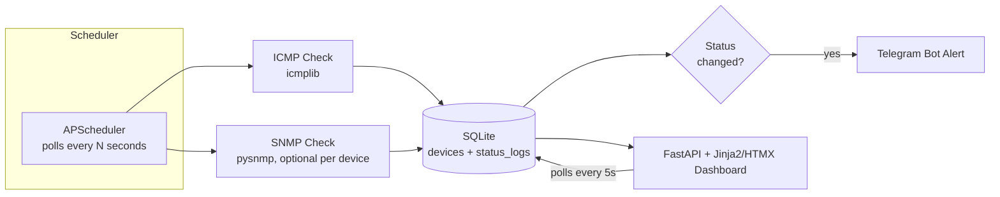

# NetWatch NMS

A lightweight, self-hosted Network Monitoring System built for a hotel IT environment — tracks the up/down status and latency of local network devices (routers, access points, PCs, printers) grouped by area, with live dashboard updates and Telegram alerts on status changes.

Built as an internship project, scoped deliberately to cover industry-standard monitoring methods (ICMP + SNMP) without the operational overhead of a full enterprise NMS.




## Problem Statement

Small hospitality properties often run a mix of networking gear and shared devices (room routers, lobby APs, office printers, PMS terminals) with no centralized way to know when something goes down — issues surface only when a guest or staff member complains. NetWatch gives IT staff a single dashboard showing live status across all monitored devices, grouped by area (Room / Public / Office), with instant Telegram alerts the moment something drops offline — closing the gap between "device fails" and "someone notices."

## Architecture



## Tech Stack & Why

| Layer | Choice | Why |
|---|---|---|
| Backend | FastAPI | Async-friendly for I/O-bound polling; minimal boilerplate |
| Database | SQLite + SQLAlchemy | Zero-config, single-file, sufficient for a bounded device count |
| Scheduler | APScheduler | In-process background polling, no separate worker/queue needed |
| Monitoring | icmplib (ICMP), pysnmp (SNMP) | The two industry-standard reachability/status protocols |
| Frontend | Jinja2 + HTMX | Live-updating dashboard with no separate JS build pipeline |
| Alerting | Telegram Bot API | Free, instant, no SMTP/infra setup required |
| Packaging | Docker + docker-compose | One-command reproducible run for anyone reviewing the project |

## Setup

### Local (WSL/Linux)

```bash
git clone <your-repo-url>
cd netwatch-nms
python3.12 -m venv venv
source venv/bin/activate
pip install -r requirements.txt

cp .env.example .env   # then fill in TELEGRAM_BOT_TOKEN and TELEGRAM_CHAT_ID
mkdir -p data

uvicorn app.main:app --reload
```
Visit `http://127.0.0.1:8000/`.

### Docker

```bash
docker compose up --build
```
Visit `http://localhost:8000/`. The SQLite file persists on the host under `./data/`.

## Design Decisions

**ICMP + light SNMP, not full SNMP trap listening.** Full SNMP trap infrastructure (a trap receiver, MIB compilation, community/security config per vendor) is genuinely industry-standard for large networks, but disproportionate for a bounded set of known devices. Polling ICMP for reachability/latency plus a couple of standard OIDs (`sysUpTime`, `sysName`) via SNMP GET covers "is it up and what is it" without that overhead.

**SQLite, not a time-series database.** Prometheus/InfluxDB are the standard choice at scale, but for a fixed, small device count, a simple `status_logs` table pruned to the last N readings per device covers uptime % and a response-time trend without adding a second service to deploy and maintain. Trade-off: this wouldn't scale gracefully past a few hundred devices or long-term historical analytics — that's the point at which a real time-series store would become worth the added complexity.

**HTMX, not React.** The dashboard needs live-updating status cards, not complex client-side state or routing. HTMX polling delivers that with server-rendered HTML fragments and zero JavaScript build tooling — meaningfully faster to build and debug solo within an internship timeframe, at the cost of true push-based real-time updates (a 5-second poll interval instead of instant WebSocket push, which is an acceptable trade-off for device status that changes on the order of seconds/minutes, not milliseconds).

## License

See [LICENSE](LICENSE).